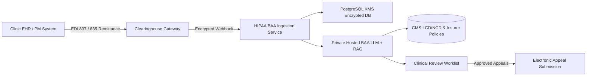

# System Architecture & Engineering Roadmap

## High-Level System Architecture

```mermaid
flowchart TD
    subgraph UI["Clinical Dashboard (HTML5 / Vanilla CSS / Modern JS)"]
        DASH[Triage & Worklist Console]
        STUDIO[Clinical Appeal Studio & Evidence Checklist]
        INTAKE[Intake Form & Bulk CSV Ingestion]
        AUDIT_UI[Action Event Stream Explorer]
    end

    subgraph API["FastAPI Application Services (Python 3.11+)"]
        AUTH[Demo Tenant Authentication & Security Guards]
        VALIDATOR[Pydantic V2 Strict Input Validation & Date Parser]
        PHI_GUARD[Client/Server Non-PHI Heuristic Scanner]
        ROUTER[REST Endpoints & CSV Stream Processing]
    end

    subgraph ENGINE["Clinical Denial Rules & Scoring Engine"]
        CARC_MAP[CARC/RARC Classification Engine (30+ Codes)]
        URGENCY[Urgency & Deadline Countdown Calculator]
        PRIORITIZER[Multi-Factor Priority Scoring Model (0-100)]
        EVIDENCE_MAP[Category-Specific Evidence Requirement Generator]
        APPEAL_GEN[Evidence-Grounded Appeal Draft Synthesizer]
    end

    subgraph DATA["Persistence Layer"]
        DB[(SQLite / Future PostgreSQL)]
        CLAIMS_TBL[Claims Ledger Table]
        APPEALS_TBL[Appeals & Versions Table]
        AUDIT_TBL[Immutable Audit Events Log]
    end

    UI -->|HTTP + X-API-Key Header| API
    API --> AUTH
    AUTH --> VALIDATOR --> PHI_GUARD --> ROUTER
    ROUTER --> ENGINE
    ENGINE --> CARC_MAP & URGENCY & PRIORITIZER & EVIDENCE_MAP & APPEAL_GEN
    ROUTER --> DATA
    DATA --> CLAIMS_TBL & APPEALS_TBL & AUDIT_TBL
    STUDIO -->|Human Clinical Verification Gate| ROUTER
```

---

## 1. Core Engineering Components

| Component | Technology | Responsibilities |
|---|---|---|
| **Clinic Dashboard** | HTML5, Vanilla CSS3, Modern JS | High-tech medical UI with glassmorphism, responsive worklists, urgency chips, priority meters, and interactive appeal studio. |
| **Backend API** | Python FastAPI + Uvicorn | RESTful endpoints, CORS, tenant isolation, date validation, and streaming CSV import/export. |
| **Denial Analysis Engine** | Deterministic Rules Engine (`backend/engine.py`) | Evaluates CARC codes (CO-16, CO-18, CO-29, CO-50, CO-96, CO-97, CO-109, CO-197, CO-252) into actionable categories, statutory citations, and required clinical evidence. |
| **Prioritization Engine** | Multi-factor Model | Combines financial exposure (up to 40 pts), deadline urgency (up to 35 pts), and category recoverability benchmarks (up to 25 pts) into a 0-100 score. |
| **Clinical Appeal Studio** | Modal / Live Editor | Evidence checklist tracker, editable appeal draft with statutory citations, copy-to-clipboard, TXT export, and human approval sign-off. |
| **Database** | SQLite + SQLAlchemy 2.0 | Structured relational persistence for claims, appeal records, and audit events. |
| **Automated Testing** | Pytest + Starlette TestClient | Full test suite covering health checks, authentication, claim workflows, date validation, and RCM rule logic. |

---

## 2. Multi-Factor Prioritization Formula

Claims in revenue cycle operations are prioritized using an operational scoring function:

$$\text{Priority Score} = \min(100, \max(1, S_{\text{financial}} + S_{\text{urgency}} + S_{\text{recovery}}))$$

1. **Financial Exposure ($S_{\text{financial}}$)**:
   - Evaluated as $\min\left(40, \left\lfloor \frac{\text{Denied Amount}}{100} \right\rfloor \right)$.
2. **Deadline Urgency ($S_{\text{urgency}}$)**:
   - $\le 7$ days remaining: $+35$ pts (**CRITICAL**)
   - $8 - 21$ days remaining: $+25$ pts (**URGENT**)
   - $22 - 45$ days remaining: $+15$ pts (**MONITOR**)
   - $> 45$ days remaining: $+5$ pts
   - Expired deadline: $+10$ pts (needs formal closure or good-cause review)
3. **Category Recoverability Benchmark ($S_{\text{recovery}}$)**:
   - Based on standard historical reversal rates:
     - Missing Information / Incomplete: $88\% \rightarrow +22$ pts
     - Duplicate Claim / Modifier Correction: $82\% \rightarrow +21$ pts
     - Authorization Missing (Retroactive appeal): $68\% \rightarrow +17$ pts
     - Medical Necessity (Conservative therapy documentation): $62\% \rightarrow +16$ pts
     - Timely Filing (Clearinghouse EDI 277 proof): $54\% \rightarrow +14$ pts

---

## 3. Production Architecture Roadmap (HIPAA & SaaS Scale)



### Key Production Requirements:
1. **HIPAA Security & BAA**:
   - Zero-PHI retention policy on client browser storage.
   - Signed Business Associate Agreements (BAA) with all cloud infrastructure and API providers.
   - Field-level AES-256 encryption for any Protected Health Information (PHI).
2. **Identity & Access Management**:
   - OIDC / SAML SSO with Multi-Factor Authentication (MFA).
   - Role-Based Access Control (RBAC): Biller, Clinician, Revenue Cycle Director, Compliance Officer.
3. **Payer Policy Retrieval (RAG)**:
   - Dedicated index of Local Coverage Determinations (LCD), National Coverage Determinations (NCD), and commercial payer medical policies with effective date tracking.
4. **Electronic EDI Integration**:
   - Automated ingestion of X12 835 Electronic Remittance Advice (ERA) files.
   - Direct electronic appeal submission via 275 Additional Information attachment transactions.
