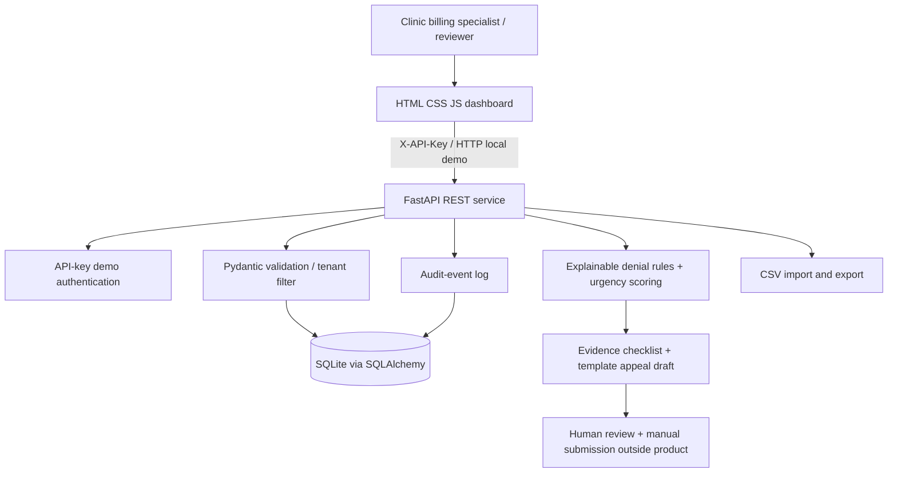

# System architecture

## Data and process

1. Billing specialist imports a synthetic claim using CSV or form.
2. API validates basic structure and stores a tenant-scoped claim record.
3. Denial rules classify common example CARC entries and generate evidence suggestions and a prioritization score.
4. Specialist opens claim, checks payer-specific facts and clinical records outside this demo.
5. Draft generator uses **only** claim fields and generic language, no invented diagnoses or clinical findings.
6. Authorized reviewer records approval; transmission to payer is deliberately absent.
7. Audit events capture create, import, status, draft and approval actions.

## Key entities

- `claims`: claim details, denial code, workflow state, tenant ID, deadline.
- `appeals`: claim ID, draft text, approval flag, tenant ID.
- `audit_events`: tenant ID, event type, related entity ID, timestamp.

## Trust boundaries and production target

This is a **local prototype and is NOT HIPAA-compliant or production-ready**. API-key security is insufficient for protected health information. SQLite is used for convenience, and dates/deadlines are entered by users rather than verified against individual payer policies. The name AI reflects the target product concept; the implemented decision support is deterministic/explainable rules, **not** a trained LLM or clinically validated prediction model.

Before real healthcare deployment, implement: signed BAA with relevant vendors, formal risk assessment; SSO/OIDC + MFA, RBAC and real per-tenant authorization; encryption in transit and at rest with KMS; managed PostgreSQL, backups and disaster recovery; secure secrets management; PHI minimization, retention and deletion; immutable audit logs; safe error handling and monitoring; tenant isolation testing and third-party security review; consent/access policies, breach response; payer-specific policy catalog maintained with effective dates; human verification of diagnosis/procedure evidence; integrations with clearinghouse/X12 835/837, EHR and payer portals under agreements; thorough regulatory and legal review. Never use sample deadline as a payer policy.

Potential later AI extension: BAA-covered model hosting with explicit PHI data controls, retrieval over dated payer policy documents, source citations, hallucination tests and clinician/billing approval gates. **No AI provider API is called in this version.**
